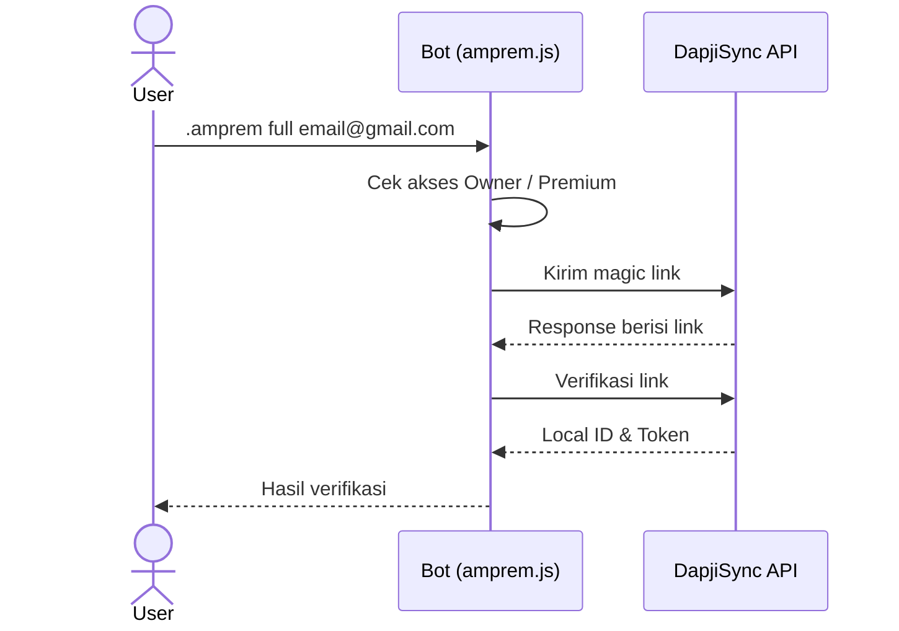

<div align="center">


# CREATE AMPREM

**Plugin WhatsApp Bot untuk magic link Alight Motion Premium**

Kirim dan verifikasi magic link lewat DapjiSync API. Berbasis Baileys.

<br/>

<a href="https://github.com/kyuuXzry/CREATE-AMPREM-1-YEAR/stargazers"></a>
<a href="https://github.com/kyuuXzry/CREATE-AMPREM-1-YEAR/network/members"></a>

<a href="https://github.com/WhiskeySockets/Baileys"></a>


</div>

<br/>

## Fitur

<table width="100%">
<tr>
<td width="33%" valign="top" align="center">
<br/>
<b>Kirim Magic Link</b><br/>
<sub>Langsung ke email tujuan</sub>
</td>
<td width="33%" valign="top" align="center">
<br/>
<b>Verifikasi Otomatis</b><br/>
<sub>Link diambil dari response API</sub>
</td>
<td width="33%" valign="top" align="center">
<br/>
<b>Satu Command</b><br/>
<sub>Send + verify lewat <code>full</code></sub>
</td>
</tr>
<tr>
<td width="33%" valign="top" align="center">
<br/>
<b>Custom Link</b><br/>
<sub>Mendukung link dari inbox</sub>
</td>
<td width="33%" valign="top" align="center">
<br/>
<b>Cancel Session</b><br/>
<sub>Batalkan kapan saja</sub>
</td>
<td width="33%" valign="top" align="center">
<br/>
<b>Local ID & Token</b><br/>
<sub>Tampil setelah verifikasi</sub>
</td>
</tr>
</table>

## Cara Pasang

**1. Install dependency**

```bash
npm install axios
```

**2. Salin plugin**

Taruh file `amprem.js` di folder `plugins/` bot kamu.

```text
plugins/
└── amprem.js
```

**3. Restart bot**

```bash
node index.js
```

Plugin ini standalone, jadi tidak mengganggu file utama bot.

## Cara Pakai

| Command | Fungsi |
| :-- | :-- |
| `.amprem send <email>` | Kirim magic link ke email |
| `.amprem verify <link>` | Verifikasi magic link |
| `.amprem full <email>` | Kirim link, lalu verifikasi otomatis |
| `.amprem cancel` | Batalkan session |

**Contoh: kirim link**

```text
User: .amprem send user@gmail.com
Bot:  Magic link terkirim!

      Gmail  : user@gmail.com
      Status : Link berhasil dikirim
```

**Contoh: send + verify**

```text
User: .amprem full user@gmail.com
Bot:  Verifikasi berhasil!

      Gmail    : user@gmail.com
      Status   : Success
      Local ID : xxxxx
```

## Alur Kerja



## Variabel yang Dibutuhkan

Pastikan bot kamu menyediakan variabel berikut ke plugin.

| Variabel | Deskripsi |
| :-- | :-- |
| `conn` | Instance WhatsApp (`makeWASocket`) |
| `m` | Message object |
| `text` | Isi pesan setelah command |
| `prefix` | Prefix bot (biasanya `.`) |
| `command` | Command yang diketik |
| `Reply` | Fungsi reply pesan |
| `isCreator` | Cek user owner |
| `isPremium` | Cek user premium |

> [!NOTE]
> Kalau nama instance di bot kamu berbeda, ganti `conn` dengan nama instance bot kamu.

## Troubleshooting

<details>
<summary><b>Link tidak muncul di response</b></summary>
<br/>
Cek inbox atau spam email, salin link verifikasi secara manual, lalu jalankan <code>.amprem verify &lt;link&gt;</code>.
</details>

<details>
<summary><b>Gagal verifikasi: link expired</b></summary>
<br/>
Jalankan <code>.amprem cancel</code>, lalu ulangi <code>.amprem send &lt;email&gt;</code>.
</details>

<details>
<summary><b>Session hilang setelah restart</b></summary>
<br/>
Session disimpan di <code>global.ampremSession</code>, jadi hilang saat bot restart. Gunakan <code>.amprem full</code> supaya tidak bergantung pada session.
</details>

<details>
<summary><b>Error Cannot find module 'axios'</b></summary>
<br/>

```bash
npm install axios
```

</details>

<details>
<summary><b>Perintah tidak merespons</b></summary>
<br/>
Pastikan pengirim adalah Owner atau Premium, dan nama variabel di bot kamu sudah sesuai dengan tabel di atas.
</details>

## Struktur

```text
CREATE-AMPREM-1-YEAR
├── assets
│   └── alight-motion.svg
├── plugins
│   └── amprem.js
├── LICENSE
└── README.md
```

## Credit

<div align="center">

**Author** · KyuuAI

<a href="https://wa.me/628567126744"></a>
<a href="https://instagram.com/Rissxzry_"></a>
<a href="https://github.com/kyuuXzry"></a>

**API Provider** · DapjiSync

<a href="https://am.dapjisync.my.id"></a>

<br/>

<sub>MIT License © 2026 KyuuAI · teks lengkap di <a href="LICENSE"><code>LICENSE</code></a></sub>

</div>
