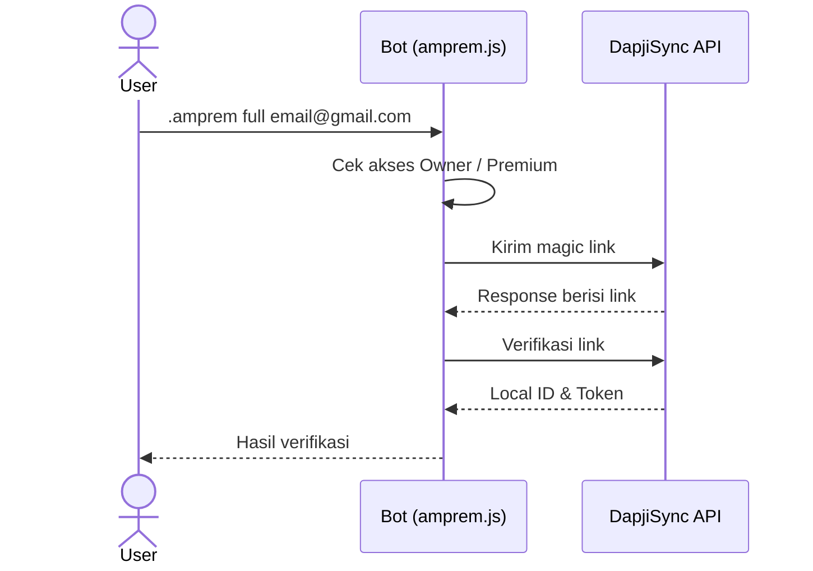

<div align="center">

<table>
<tr>
<td valign="middle" align="center" width="170">

</td>
<td valign="middle" align="left">

<h1>CREATE AMPREM</h1>

<b>Plugin WhatsApp Bot untuk magic link Alight Motion Premium</b>
<br/>
<sub>Kirim, verifikasi, dan selesai dalam satu command. Berbasis Baileys, via DapjiSync API.</sub>

</td>
</tr>
</table>

<a href="https://github.com/kyuuXzry/CREATE-AMPREM-1-YEAR">
  
</a>

<br/>

<a href="https://github.com/kyuuXzry/CREATE-AMPREM-1-YEAR/stargazers"></a>
<a href="https://github.com/kyuuXzry/CREATE-AMPREM-1-YEAR/network/members"></a>
<a href="https://github.com/kyuuXzry/CREATE-AMPREM-1-YEAR/issues"></a>
<a href="https://github.com/kyuuXzry/CREATE-AMPREM-1-YEAR/commits"></a>


<br/>


<a href="https://github.com/WhiskeySockets/Baileys"></a>


</div>

<br/>

<table align="center" width="100%">
<tr>
<td align="center" width="25%">
<h2>4</h2>
<sub>COMMAND</sub>
</td>
<td align="center" width="25%">
<h2>1</h2>
<sub>FILE PLUGIN</sub>
</td>
<td align="center" width="25%">
<h2>1</h2>
<sub>DEPENDENCY</sub>
</td>
<td align="center" width="25%">
<h2>2</h2>
<sub>ROLE AKSES</sub>
</td>
</tr>
</table>

<br/>

## &nbsp;01 / Quick Start

Plugin ini standalone. Cukup taruh di folder `plugins/` tanpa mengganggu file utama bot.

```bash
# 1. install dependency
npm install axios

# 2. salin plugin ke folder plugins/ bot kamu
cp amprem.js plugins/amprem.js

# 3. restart bot
node index.js
```

Setelah bot hidup, kirim `.amprem full email@gmail.com` untuk mencoba.

<br/>

## &nbsp;02 / Command

<table width="100%">
<tr>
<td width="50%" valign="top">

**&nbsp;send**

Kirim magic link ke email.

```bash
.amprem send email@gmail.com
```

</td>
<td width="50%" valign="top">

**&nbsp;verify**

Verifikasi magic link. Mendukung link manual dari inbox.

```bash
.amprem verify <link>
```

</td>
</tr>
<tr>
<td width="50%" valign="top">

**&nbsp;full**

Kirim link lalu verifikasi otomatis. Link diambil langsung dari response API.

```bash
.amprem full email@gmail.com
```

</td>
<td width="50%" valign="top">

**&nbsp;cancel**

Batalkan session kapan saja.

```bash
.amprem cancel
```

</td>
</tr>
</table>

<br/>

## &nbsp;03 / Alur Kerja



### Contoh hasil di chat

<table width="100%">
<tr>
<td width="50%" valign="top">

**send**

```text
User: .amprem send user@gmail.com
Bot:  Magic link terkirim!

      Gmail  : user@gmail.com
      Status : Link berhasil dikirim
```

</td>
<td width="50%" valign="top">

**full**

```text
User: .amprem full user@gmail.com
Bot:  Verifikasi berhasil!

      Gmail    : user@gmail.com
      Status   : Success
      Local ID : xxxxx
```

</td>
</tr>
</table>

<br/>

## &nbsp;04 / Variabel yang Dibutuhkan

Pastikan struktur bot kamu menyediakan variabel berikut ke plugin.

| Variabel | Deskripsi |
| :-- | :-- |
| `conn` | Instance WhatsApp (`makeWASocket`) |
| `m` | Message object |
| `text` | Isi pesan setelah command |
| `prefix` | Prefix bot (biasanya `.`) |
| `command` | Command yang diketik |
| `Reply` | Fungsi reply pesan |
| `isCreator` | Cek user owner |
| `isPremium` | Cek user premium |

> [!NOTE]
> Kalau nama instance di bot kamu berbeda, ganti `conn` dengan nama instance bot kamu.

<br/>

## &nbsp;05 / FAQ & Troubleshooting

<details>
<summary><b>Link tidak muncul di response</b></summary>
<br/>
Cek inbox atau spam email, salin link verifikasi secara manual, lalu jalankan <code>.amprem verify &lt;link&gt;</code>.
</details>

<details>
<summary><b>Gagal verifikasi: link expired</b></summary>
<br/>
Jalankan <code>.amprem cancel</code>, lalu ulangi <code>.amprem send &lt;email&gt;</code>.
</details>

<details>
<summary><b>Session hilang setelah restart</b></summary>
<br/>
Session disimpan di <code>global.ampremSession</code>, jadi hilang saat bot restart. Gunakan <code>.amprem full</code> supaya tidak bergantung pada session.
</details>

<details>
<summary><b>Error <code>Cannot find module 'axios'</code></b></summary>
<br/>

```bash
npm install axios
```

</details>

<details>
<summary><b>Perintah tidak merespons</b></summary>
<br/>
Pastikan pengirim adalah Owner atau Premium, dan nama variabel di bot kamu sudah sesuai dengan tabel di atas.
</details>

<br/>

## &nbsp;06 / Struktur Repositori

```text
CREATE-AMPREM-1-YEAR
├── assets
│   └── alight-motion.svg
├── plugins
│   └── amprem.js
├── LICENSE
└── README.md
```

<br/>

## &nbsp;07 / Credit

<table width="100%">
<tr>
<td width="50%" valign="top" align="center">

<sub><b>AUTHOR</b></sub>

**KyuuAI**

<a href="https://wa.me/628567126744"></a>
<a href="https://instagram.com/Rissxzry_"></a>
<a href="https://github.com/kyuuXzry"></a>

</td>
<td width="50%" valign="top" align="center">

<sub><b>API PROVIDER</b></sub>

**DapjiSync**

<a href="https://am.dapjisync.my.id"></a>

</td>
</tr>
</table>

<div align="center">

<br/>

<a href="https://github.com/kyuuXzry/CREATE-AMPREM-1-YEAR/stargazers"></a>

<br/><br/>

<sub>MIT License © 2026 KyuuAI · teks lengkap di <a href="LICENSE"><code>LICENSE</code></a></sub>

</div>
