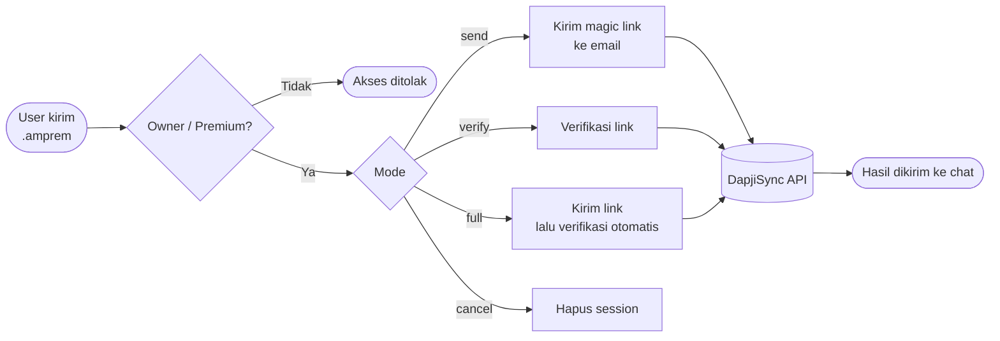

<div align="center">

<br/>


<h1>AMPREM</h1>

<p><b>Plugin WhatsApp Bot untuk Alight Motion Premium</b></p>

<a href="https://github.com/kyuuXzry/AMPREM">
  
</a>

<br/>

<a href="https://github.com/kyuuXzry/AMPREM/stargazers">
  
</a>
<a href="https://github.com/kyuuXzry/AMPREM/network/members">
  
</a>
<a href="https://github.com/kyuuXzry/AMPREM/issues">
  
</a>
<a href="https://github.com/kyuuXzry/AMPREM/commits">
  
</a>

<br/>


<a href="https://github.com/WhiskeySockets/Baileys">
  
</a>


<br/>


<br/><br/>


</div>

<br/>

<div align="center">

<h2>&nbsp;Tentang</h2>

</div>

Plugin WhatsApp Bot untuk mengirim dan memverifikasi **magic link Alight Motion Premium** (amprem) lewat DapjiSync API. Berbasis [Baileys](https://github.com/WhiskeySockets/Baileys).

Plugin ini menangani seluruh alur amprem, mulai dari kirim magic link ke email sampai verifikasi link-nya. Sifatnya standalone, jadi cukup taruh di folder `plugins/` tanpa mengganggu file utama bot.

<br/>

<div align="center">


<h2>&nbsp;Fitur</h2>

</div>

<table align="center" width="100%">
<tr>
<td width="33%" valign="top" align="center">


**Kirim Magic Link**

Kirim magic link langsung ke email tujuan.

</td>
<td width="33%" valign="top" align="center">


**Verifikasi Otomatis**

Link diekstrak otomatis dari response API lalu diverifikasi.

</td>
<td width="33%" valign="top" align="center">


**Satu Command**

Flow send + verify jalan sekaligus lewat `.amprem full`.

</td>
</tr>
<tr>
<td width="33%" valign="top" align="center">


**Custom Link**

Mendukung link manual yang diambil dari inbox.

</td>
<td width="33%" valign="top" align="center">


**Cancel Session**

Batalkan session kapan saja dengan satu perintah.

</td>
<td width="33%" valign="top" align="center">


**Info Local ID & Token**

Tampilkan Local ID dan token setelah verifikasi berhasil.

</td>
</tr>
</table>

<div align="center">

<sub>Akses plugin ini dibatasi untuk <b>Owner</b> dan <b>Premium</b>.</sub>

</div>

<br/>

<div align="center">


<h2>&nbsp;Cara Kerja</h2>

</div>



<br/>

<div align="center">


<h2>&nbsp;Cara Pakai</h2>

</div>

| Command | Fungsi |
| :-- | :-- |
| `.amprem send <email>` | Kirim magic link ke email |
| `.amprem verify <link>` | Verifikasi magic link |
| `.amprem full <email>` | Kirim link, lalu verifikasi otomatis |
| `.amprem cancel` | Batalkan session |

<details>
<summary><b>Contoh perintah</b></summary>

<br/>

**Kirim magic link**

```bash
.amprem send email@gmail.com
```

**Verifikasi link**

```bash
.amprem verify <link>
```

**Send + auto-verify**

```bash
.amprem full email@gmail.com
```

**Batalkan session**

```bash
.amprem cancel
```

</details>

<br/>

<div align="center">

<h3>&nbsp;Contoh Hasil</h3>

</div>

<table align="center" width="100%">
<tr>
<td width="50%" valign="top">

**Kirim Link**

```text
User: .amprem send user@gmail.com
Bot:  Magic link terkirim!

      Gmail  : user@gmail.com
      Status : Link berhasil dikirim
```

</td>
<td width="50%" valign="top">

**Auto-Verify**

```text
User: .amprem full user@gmail.com
Bot:  Verifikasi berhasil!

      Gmail    : user@gmail.com
      Status   : Success
      Local ID : xxxxx
```

</td>
</tr>
</table>

<br/>

<div align="center">


<h2>&nbsp;Cara Pasang</h2>

</div>

### &nbsp;1. Install dependency

```bash
npm install axios
```

| Package | Fungsi |
| :-- | :-- |
| `axios` | HTTP client |

### &nbsp;2. Copy file plugin

Taruh file `amprem.js` di folder `plugins/` bot kamu.

```text
plugins/
└── amprem.js
```

### &nbsp;3. Pastikan variabel tersedia

| Variabel | Deskripsi |
| :-- | :-- |
| `conn` | Instance WhatsApp (`makeWASocket`) |
| `m` | Message object |
| `text` | Isi pesan setelah command |
| `prefix` | Prefix bot (biasanya `.`) |
| `command` | Command yang diketik |
| `Reply` | Fungsi reply pesan |
| `isCreator` | Cek user owner |
| `isPremium` | Cek user premium |

> [!NOTE]
> Kalau nama instance di bot kamu berbeda (misalnya `alip`, `kyuu`, dll), ganti `conn` dengan nama instance bot kamu.

### &nbsp;4. Restart bot

```bash
node index.js
```

<br/>

<div align="center">


<h2>&nbsp;Struktur</h2>

</div>

```text
.
├── README.md
├── LICENSE
├── assets/
│   └── alight-motion.svg
└── plugins/
    └── amprem.js
```

<br/>

<div align="center">


<h2>&nbsp;Troubleshooting</h2>

</div>

| Masalah | Solusi |
| :-- | :-- |
| Link tidak muncul di response | Cek inbox/spam email, salin link verifikasi secara manual, lalu jalankan `.amprem verify <link>`. |
| Gagal verifikasi: link expired | Jalankan `.amprem cancel`, lalu ulangi `.amprem send <email>`. |
| Session hilang setelah restart | Session disimpan di `global.ampremSession`. Gunakan `.amprem full` supaya tidak bergantung pada session. |
| `Cannot find module 'axios'` | Jalankan `npm install axios`. |
| Perintah tidak merespons | Pastikan pengirim adalah Owner atau Premium dan nama variabel bot sudah sesuai. |

<br/>

<div align="center">


<h2>&nbsp;Tech Stack</h2>

<table>
<tr>
<td align="center" width="25%">
<br>
<b>Node.js</b>
</td>
<td align="center" width="25%">
<br>
<b>JavaScript</b>
</td>
<td align="center" width="25%">
<br>
<b>Baileys</b>
</td>
<td align="center" width="25%">
<br>
<b>Axios</b>
</td>
</tr>
</table>


<h2>&nbsp;Credit</h2>

<sub><b>AUTHOR</b></sub>
<br/><br/>
<b>KyuuAI</b>
<br/><br/>

<a href="https://wa.me/628567126744">
  
</a>
<a href="https://instagram.com/Rissxzry_">
  
</a>
<a href="https://github.com/kyuuXzry">
  
</a>

<br/><br/>

<sub><b>API PROVIDER</b></sub>
<br/><br/>
<b>DapjiSync</b>
<br/><br/>

<a href="https://am.dapjisync.my.id">
  
</a>

<br/><br/>

<a href="https://github.com/kyuuXzry/AMPREM/stargazers">
  
</a>

<br/><br/>


</div>

<br/>

<div align="center">

<h2>&nbsp;License</h2>

MIT License © 2026 KyuuAI. Teks lengkap lisensi ada di file <a href="LICENSE"><code>LICENSE</code></a>.

<br/>


</div>
